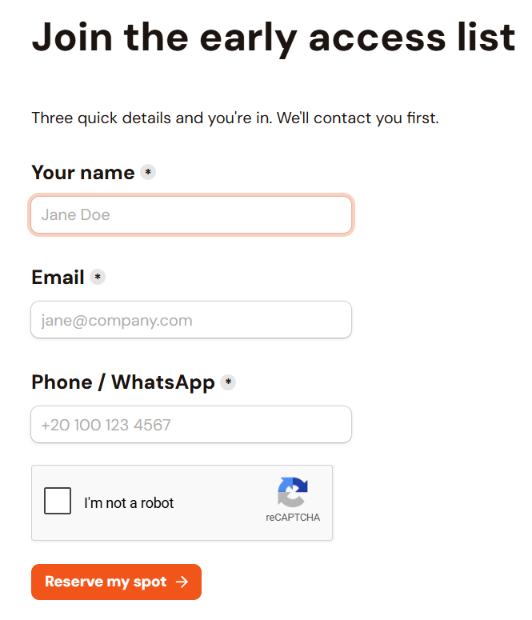
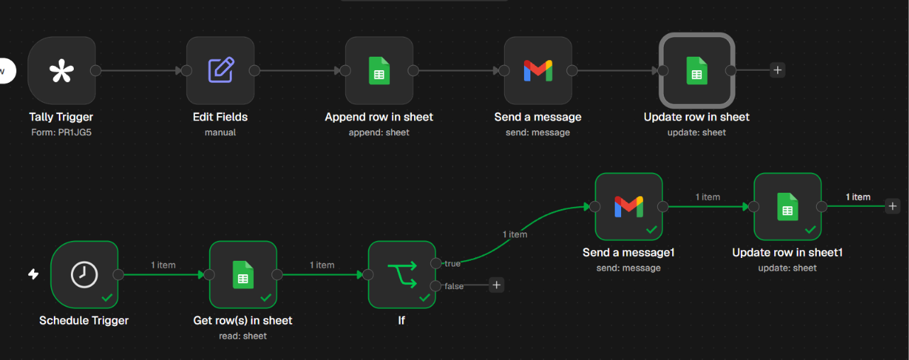
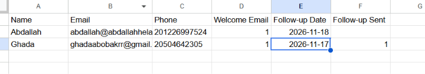
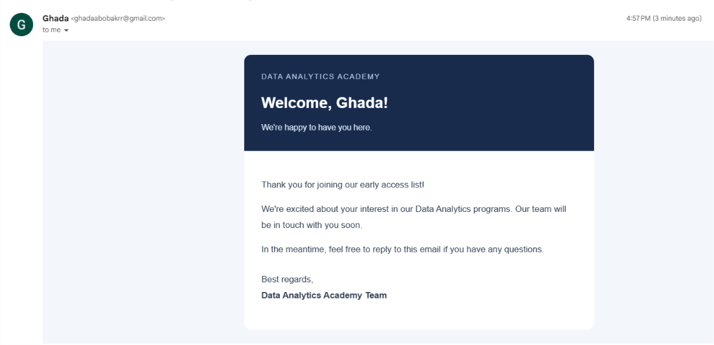
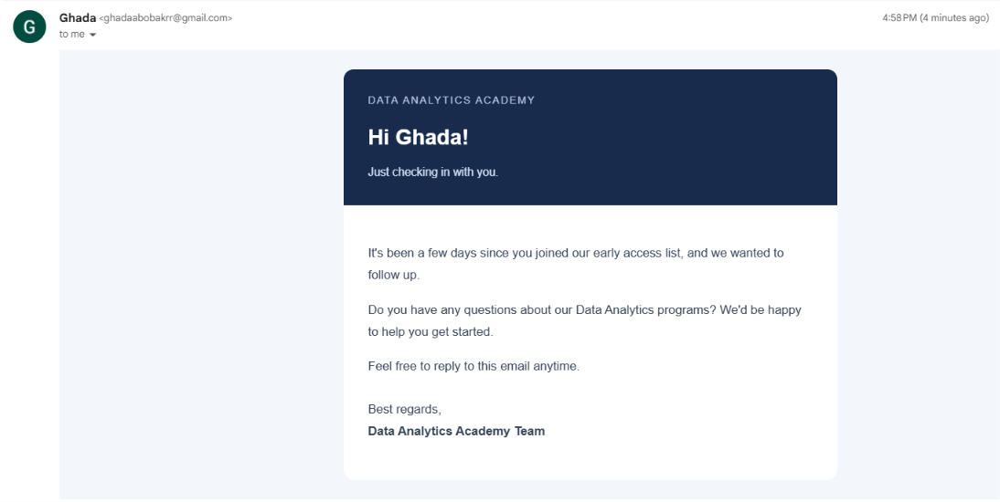

# Client Onboarding & Automated Follow-up (n8n)

A two-branch automation that captures registrations from a Tally form, sends a styled HTML welcome email, and schedules a personalized follow-up three days later.

## Workflow overview

**Onboarding:** Tally Trigger → Edit Fields → Google Sheets (Append Row) → Gmail (Welcome Email) → Google Sheets (Update Row)

**Follow-up:** Schedule Trigger (daily, 10:00 AM) → Google Sheets (Get Rows matching today's date) → IF (`Follow-up Sent` ≠ `1`) → Gmail (Follow-up Email) → Google Sheets (Update Row)

## Screenshots

### Tally Registration Form

The registration form collects the client's name, email address, and phone number.

### n8n Workflow Overview

Both onboarding and scheduled follow-up branches in a single n8n workflow.

### Google Sheets Database

Client records, welcome-email status, follow-up date, and follow-up status.

### HTML Welcome Email

A personalized HTML welcome message sent after a new registration.

### HTML Follow-up Email

A personalized message sent to eligible clients on the scheduled follow-up date.

## Features

- Capitalizes the first letter of each word in the client's name
- Removes a leading `+` from phone numbers
- Stores registrations in Google Sheets
- Sends responsive, personalized HTML emails
- Calculates a follow-up date three days after registration
- Tracks email delivery steps with `Welcome Email` and `Follow-up Sent` markers

## Google Sheets schema

Create a sheet with exactly these headers:

| Name | Email | Phone | Welcome Email | Follow-up Date | Follow-up Sent |
|---|---|---|---|---|---|

The follow-up date uses `yyyy-MM-dd` formatting. A `1` marker represents an email that was sent by the automation.

## Setup

1. Import [`n8n_client_onboarding_followup.json`](n8n_client_onboarding_followup.json) into n8n.
2. Install the **Tally Trigger community node** (`n8n-nodes-tallyforms`) if your n8n instance does not already provide it. Community node support depends on your hosting environment.
3. Set your Tally form ID and reconnect the Tally credential in the trigger.
4. Configure your Google Sheet document ID in **all** Google Sheets nodes, select the appropriate sheet, and reconnect Google Sheets credentials.
5. Reconnect Gmail credentials in both email nodes.
6. Confirm the Tally question keys in **Edit Fields** match your actual form. The sample uses keys from the author's form, which will differ for another form.
7. Set the n8n workflow timezone to **Africa/Cairo** (or your intended local timezone).
8. Test both branches before publishing. Once tested, publish/activate the workflow.

## Test the workflow

- Submit the form using a **unique test email address** you control, and confirm the welcome email arrives.
- Verify a row was created and the welcome status/date were updated.
- Set the follow-up date of a test row to today's date and leave `Follow-up Sent` empty or `0`.
- Execute the scheduled branch manually; verify the follow-up email arrives and `Follow-up Sent` becomes `1`.
- Rerun the check and verify that the IF node prevents a duplicate follow-up.

